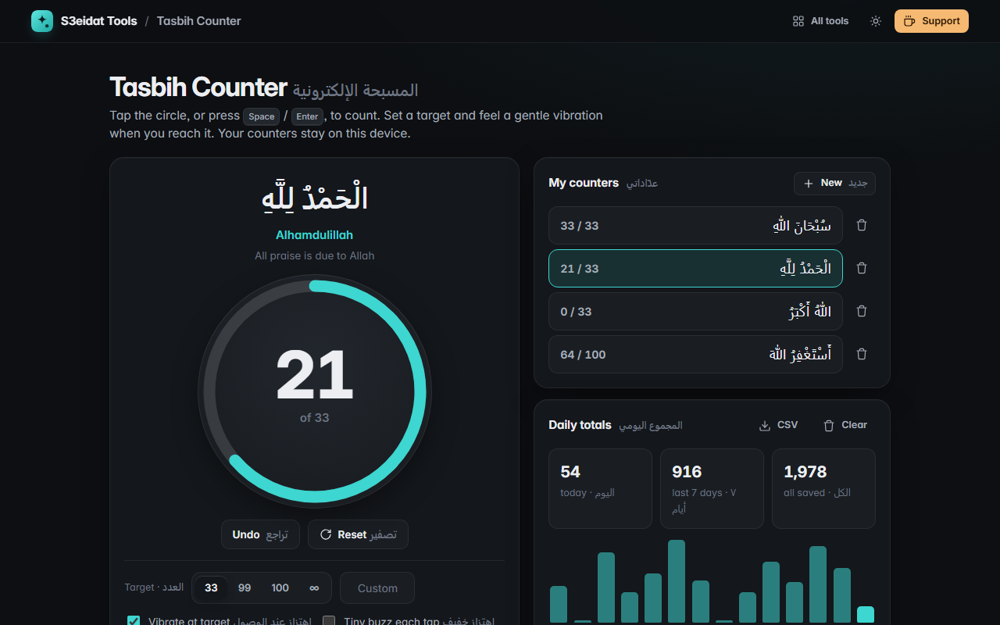

# Tasbih Counter · المسبحة الإلكترونية

> A simple digital tasbih. Free, private, and it runs entirely in your browser.

### ▶ [Open Tasbih Counter](https://s3eidat.github.io/tasbih-counter/)



## Features

- **Big tap circle**, or press **Space** / **Enter** to count, **Backspace** to undo one
- **Targets** of 33, 99, 100, any custom number, or no target; the ring fills as you go and rounds continue after the target
- **Gentle vibration** when you reach the target (and an optional tiny buzz on each tap) on devices that support it
- **Dhikr list** in Arabic with transliteration and meaning, or write your own
- **Several saved counters**, each with its own count and target
- **Daily totals** for the last 14 days, with a CSV export
- **Reset with confirmation** (tap twice), so a stray tap never wipes a count
- **Keep the screen on** while counting (Screen Wake Lock, only when you press the button)
- Bilingual interface (English and Arabic)

## Limits

- iPhones and iPads don't let web pages vibrate, so the vibration options do nothing there. Counting still works.
- Counters live in this browser's storage. Clearing site data, or using another browser or device, starts fresh.

## Privacy

Your counts never leave your device. There is no server, no account, no analytics.
The page ships with a strict Content-Security-Policy (`connect-src 'self'`), so the browser
itself blocks any attempt to send data anywhere.

## Run it yourself

It's plain HTML, CSS and JavaScript with no build step:

```bash
git clone https://github.com/s3eidat/tasbih-counter
cd tasbih-counter
python -m http.server 8000
```

Then open http://localhost:8000.

## Support

If this saved you time, **[buy me a coffee ☕](https://s3eidat.github.io/coffee/)**. It keeps every tool free.

---

Part of **[S3eidat Tools](https://s3eidat.github.io/)**: 100+ free, private tools that run in your browser. MIT licensed.
